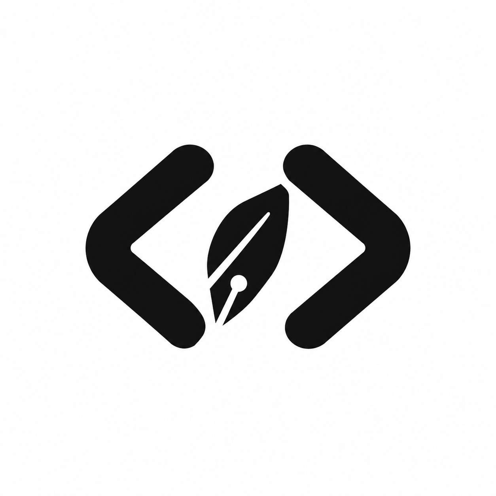

# Navi Client (`navi-app`)

<div align="center">
  
  <h3>Native Kiosk & Socratic AI Programming Examination Desktop Client</h3>
  <p>Engineered for high-integrity computer science examinations, laboratory evaluations, and algorithmic assessments.</p>
</div>

---

## 🌐 Navi Ecosystem Architecture

Navi is built as a three-tier distributed assessment platform:

| Component | Repository | Technology | Description |
| :--- | :--- | :--- | :--- |
| **Desktop Client** | [willgregorry/navi-app](https://github.com/willgregorry/navi-app) | Electron, React 19, TypeScript, Vite | Native locked-down kiosk client with low-level keyboard interception & Socratic tutor |
| **Web Portal & Console** | [willgregorry/navi-web](https://github.com/willgregorry/navi-web) | React 19, TypeScript, Vite, Glassmorphism | Real-time proctor dashboard, exam studio, telemetry feeds, and official download station |
| **Backend API Engine** | [sulthonaw/navi-api](https://github.com/sulthonaw/navi-api) | FastAPI, Python 3.11, PostgreSQL, Gemini AI | Socratic AI reasoning engine, room management, violation logging, and evaluation services |

---

## ⚡ Core Features

- **🛡️ Native Win32 Low-Level Kiosk Lock-In**:
  Utilizes `SetWindowsHookEx(WH_KEYBOARD_LL)` at the Windows OS kernel layer to intercept shortcut combinations including <kbd>Alt+Tab</kbd>, <kbd>Win+D</kbd>, <kbd>Ctrl+Esc</kbd>, and multi-monitor window jumping before any external application receives focus.
- **🧠 Socratic AI Guidance (Pedagogical - No Direct Solutions)**:
  Integrates with Gemini-powered reasoning to guide students through `SyntaxError`, `IndexError`, and algorithmic logic bottlenecks via Socratic inquiries in English (`language: "en"`), fostering genuine cognitive mastery without spoon-feeding answers.
- **🎨 Obsidian Brutalist & Glassmorphic UI**:
  High-contrast, distraction-free monochrome design system (`#09090b` canvas, Fira Code monospace, Plus Jakarta Sans typography) tailored for high-stakes exam environments.
- **🐍 Local Subprocess Sandboxing**:
  Executes Python 3.11 code solutions in isolated sub-processes with memory limits, execution timeout monitors, and automated sample test case verification.
- **📡 Real-Time Security Telemetry**:
  Automatically transmits violation timestamps, focus blur counts, and Socratic hint quota consumption back to the educator console.

---

## 🛠️ Tech Stack

- **Framework**: [Electron](https://www.electronjs.org/) + [React 19](https://react.dev/) + [TypeScript](https://www.typescriptlang.org/)
- **Build Tool**: [Vite 6](https://vitejs.dev/)
- **Styling**: Monochromatic Obsidian Brutalist Design System with Glassmorphism
- **Icons**: [Lucide React](https://lucide.dev/)
- **Audio**: WebAudio API Synthesized Acoustic Alerts

---

## 🚀 Getting Started

### Prerequisites

- **Node.js**: v18.0.0 or higher
- **npm**: v9.0.0 or higher
- **Python**: 3.10+ (for local test execution runtime)
- **OS**: Windows 10 / 11 (for native Win32 keyboard hook capabilities)

### Installation

1. Clone the repository:
   ```bash
   git clone https://github.com/willgregorry/navi-app.git
   cd navi-app
   ```

2. Install dependencies:
   ```bash
   npm install
   ```

3. Configure environment variables (`.env`):
   ```env
   VITE_API_URL=https://navi.willygregory.site/api/v1
   ```

4. Launch the desktop kiosk in development mode:
   ```bash
   npm run dev
   ```

5. Build for production:
   ```bash
   npm run build
   ```

---

## 👥 Related Repositories

- Web Portal & Teacher Console: **[https://github.com/willgregorry/navi-web](https://github.com/willgregorry/navi-web)**
- Backend API & Socratic Engine: **[https://github.com/sulthonaw/navi-api](https://github.com/sulthonaw/navi-api)**

---

## 📄 License

Academic and institutional use licensed under the MIT License.
Developed for Universitas Brawijaya and computer science education institutions.
